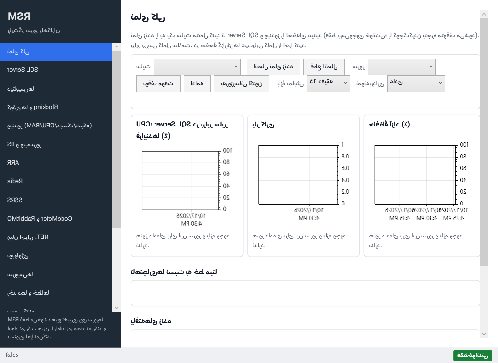
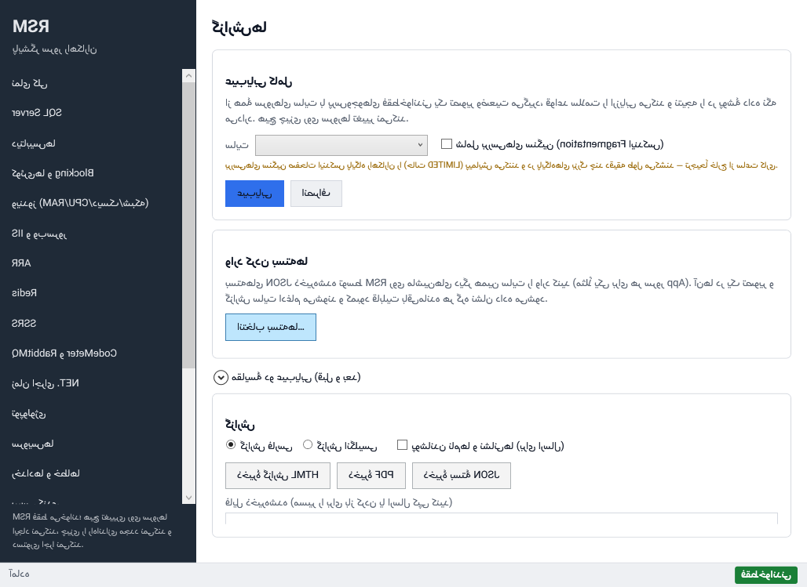
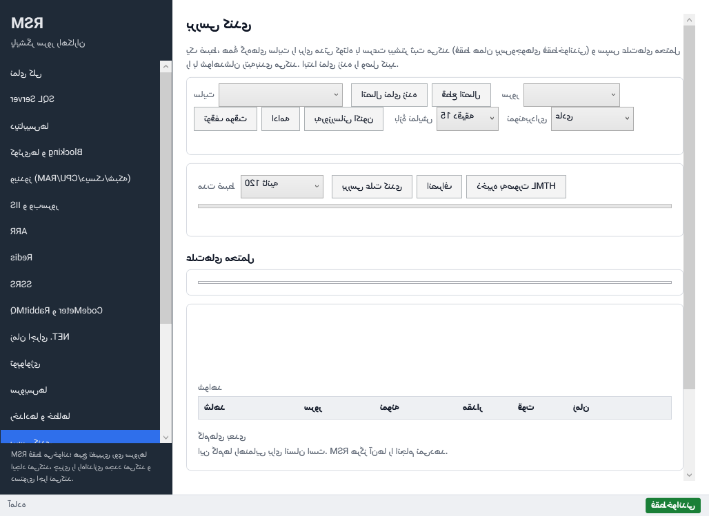
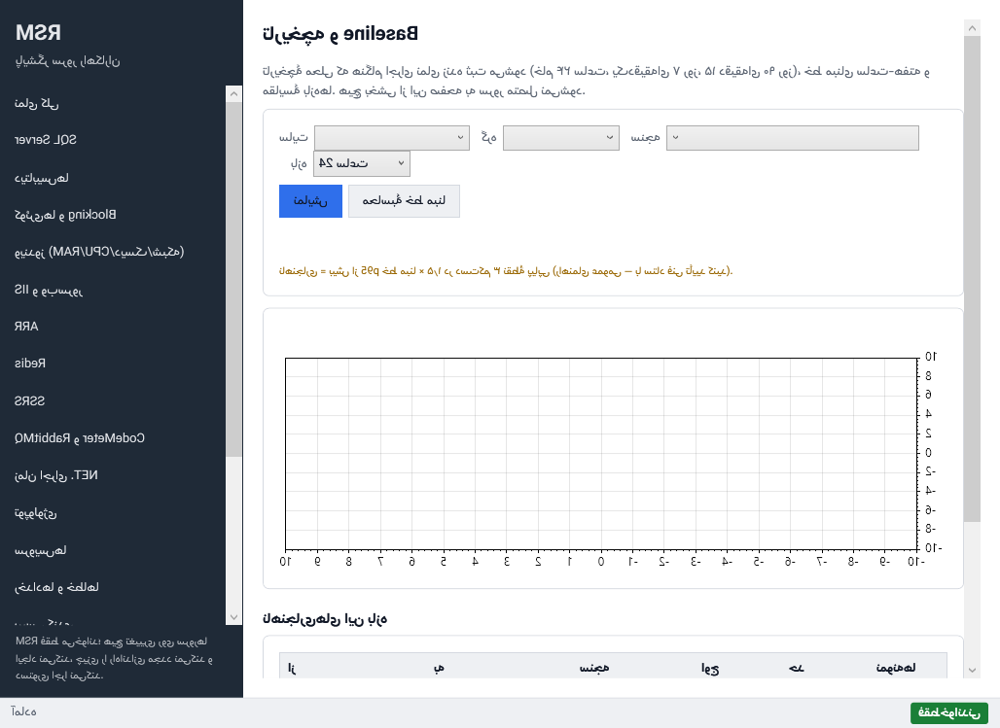

# راهنمای کاربر RSM (فارسی)

پایشگر سرور راهکاران (RSM) ابزاری **فقط‌خواندنی** برای عیب‌یابی سرورهای راهکاران روی Windows Server، IIS و SQL
Server است. هیچ تغییری در سرور نمی‌دهد. چیزی را Kill، بازیافت، راه‌اندازی مجدد، Shrink یا «اصلاح» نمی‌کند و همهٔ
توصیه‌هایش متنی است برای انسان. راهنمای انگلیسی: [README.md](README.md).

> تصاویر از `RSM.exe` منتشرشده گرفته می‌شوند. CI ویندوز فرمان `RSM.exe --portable --ui-snapshots` را اجرا می‌کند که
> همهٔ صفحه‌ها را به فارسی و انگلیسی نمایش می‌دهد و در پوشهٔ داده ذخیره می‌کند. اگر پیام کامیتِ push شامل
> `[guide-screenshots]` باشد، یک job در CI این تصاویر را در `images/` کامیت می‌کند.

## ۱. شروع

۱. `RSM.exe` را روی سرور یا ایستگاه مدیر کپی کنید. قابل‌حمل است و چیزی نصب نمی‌کند.
   - با `RSM.exe --portable` همهٔ داده‌ها کنار فایل اجرایی در `data\` می‌ماند.
   - در غیر این صورت RSM از `%LOCALAPPDATA%\RSM` استفاده می‌کند.

۲. با کاربر عادی اجرا کنید. برخی داده‌های ویندوز و IIS دسترسی مدیر محلی می‌خواهد. RSM هرگز خودش را Elevate نمی‌کند؛
   ماتریس قابلیت‌ها می‌گوید چه چیزی کم است و چرا.

۳. روی سرور پایگاه داده، لاگین کم‌دسترسی `rsm_monitor` را بسازید (اسکریپت و دسترسی‌ها در
   [PERMISSIONS.md](../../PERMISSIONS.md)).

## ۲. سایت‌ها و گره‌ها

صفحهٔ **سایت‌ها**: سایت و سپس گره‌ها (ماشین‌ها) را با نقش‌هایشان اضافه کنید:

- Data، Report، App، ARR، Redis، Lock (CodeMeter)، Workflow (RabbitMQ).
- نشانی SQL Server و Redis. رمزها با DPAPI برای کاربر جاری محافظت می‌شوند یا ذخیره نمی‌شوند.
- **آزمون اتصال** ماتریس قابلیت‌ها را پر می‌کند: چه چیزی با این اعتبارنامه‌ها کار می‌کند و آنچه کار نمی‌کند چگونه
  اعطا شود.

تنظیمات ویژهٔ راهکاران (نام پایگاه‌ها، فایل نسخه، الگوی کارهای ستاد فنی) اختیاری و با برچسب *تأییدنشده* هستند.

## ۳. عیب‌یابی کامل و گزارش‌ها

صفحهٔ **گزارش‌ها** ← **عیب‌یابی**: همهٔ جمع‌آورهای تصویر را یک بار برای هر گره، پشت سر هم و فقط‌خواندنی اجرا
می‌کند و سپس قواعد را ارزیابی می‌کند ([RULES.md](../../RULES.md)).

- بررسی‌های *سنگین* پیش‌فرض خاموش‌اند و زمان تقریبی دارند.
- خروجی‌ها در `reports\` پوشهٔ داده ذخیره می‌شوند:
  - **HTML** فارسی یا انگلیسی؛
  - **PDF** که با WebView2 داخلی و آفلاین چاپ می‌شود. اگر WebView2 نباشد، HTML ذخیره می‌شود و RSM می‌گوید آن را از
    مرورگر چاپ کنید؛
  - **بستهٔ JSON**. گزینهٔ *ماسک* همهٔ نام‌ها و نشانی‌ها را برای اشتراک مستعار می‌کند.
- **وارد کردن بسته‌ها** بسته‌های گرفته‌شده روی چند ماشینِ یک سایت را در یک تصویر و گزارش ادغام می‌کند. مثلاً یک
  بسته روی هر سرور App برای داده‌های محلی IIS، و یکی روی SQL Server. گزارش بسته‌های منبع و کمبود قابلیتِ باقی‌مانده
  در هر گره را نشان می‌دهد.
- **مقایسهٔ دو عیب‌یابی (قبل و بعد)**: یک عیب‌یابی قبلی و یکی بعدی را انتخاب کنید (مثلاً پیش و پس از به‌روزرسانی).
  RSM نشان می‌دهد:
  - یافته‌های جدید، رفع‌شده یا با شدت تغییرکرده؛
  - اعدادی که دست‌کم ۱۰٪ تغییر کرده‌اند (انتظارها، p95 هر سایت IIS، CPU، حافظه، تأخیر فایل…)؛
  - مقدارهایی که عوض شده‌اند (نسخه‌ها، پرهزینه‌ترین دستور، انتظارهای برتر).

## ۴. نمای زنده

همهٔ صفحه‌های زنده نوار ابزار مشترک دارند: سایت، **اتصال**، توقف یا ادامه، پنجرهٔ زمانی و فاصلهٔ نمونه‌برداری.

- RSM سربار خودش را می‌سنجد و نشان می‌دهد.
- RSM هنگام کندی یک جمع‌آور، آن را کمتر اجرا می‌کند.
- RSM هنگام کوچک‌شدن پنجره متوقف می‌شود.

صفحهٔ **نمای کلی** **ناهنجاری‌ها نسبت به خط مبنا** را هم نشان می‌دهد: سنجه‌ای بیش از p95 ساعت-هفته × ۱٫۵ در دست‌کم
۳ نمونهٔ پیاپی. این یک راهنمای عمومی است؛ با ستاد فنی تأیید کنید.

## ۵. چرا راهکاران کند است؟

صفحهٔ **کندی**. ابتدا نمای زنده را وصل کنید، سپس *هنگامی که کاربران کندی گزارش می‌دهند* ضبط را آغاز کنید.

۱. مدت ضبط را انتخاب کنید (پیش‌فرض ۱۲۰ ثانیه) و **بررسی علت کندی** را بزنید.

۲. در این مدت همهٔ جمع‌آورهای همهٔ گره‌ها با آهنگ بررسی (حدود سه برابر) و همان پرس‌وجوهای فقط‌خواندنی اجرا می‌شوند.

۳. نتیجه فهرست رتبه‌بندی‌شدهٔ علت‌های محتمل است. هر علت نشان می‌دهد:
   - میزان اطمینان؛
   - شواهد (مقدار، گره، زمان)؛
   - زمینه (مثلاً دستور سر زنجیرهٔ قفل)؛
   - خط زمانی مشترک نمودارهای شواهد؛
   - **گام‌های بعدی فقط به‌صورت متن**؛ RSM هرگز آن‌ها را خودش انجام نمی‌دهد.

۴. بررسی‌ها ذخیره می‌شوند و با **ذخیره به‌صورت HTML** صادر می‌شوند. بررسی‌های قبلی از فهرست دوباره باز می‌شوند.

## ۶. تاریخچه، خط مبنا و مقایسه

هنگام اجرای نمای زنده، RSM همهٔ سنجه‌ها را به‌صورت محلی ثبت می‌کند:

| تفکیک | مدت نگهداری |
|---|---|
| خام | ۲۴ ساعت |
| یک‌دقیقه‌ای | ۷ روز |
| ۱۵ دقیقه‌ای | ۹۰ روز |

صفحهٔ **تاریخچه** نشان می‌دهد:

- **نمودار** سنجه با p95 خط مبنا، حد ناهنجاری و نوارهای ناهنجاری.
- **خط مبنا**: میانه و p95 هر ساعت هفته (از شنبه) از ۴ هفتهٔ اخیر. روزانه دوباره محاسبه می‌شود و حدود دو هفته
  تاریخچه لازم دارد.
- **مقایسهٔ بازه‌ها**: هفتهٔ گذشته در برابر این هفته، یا هفتهٔ پیش و پس از یک تاریخ (مثلاً به‌روزرسانی).

## ۷. اجرای بدون رابط: RSM.Cli

`RSM.Cli.exe` همان پروفایل‌ها، پوشهٔ داده و جمع‌آورهای فقط‌خواندنی را به کار می‌برد. فقط تا وقتی کنسول باز است اجرا
می‌شود و هرگز سرویس یا کار زمان‌بندی‌شده نصب نمی‌کند. فرمان‌ها در راهنمای انگلیسی (بخش ۸) آمده است.

## ۸. پوشهٔ داده

پوشه‌ها: `sites`، `snapshots`، `history`، `investigations`، `reports`، `logs`، `webview2`. با حذف این پوشه همهٔ
آنچه RSM نوشته پاک می‌شود.

