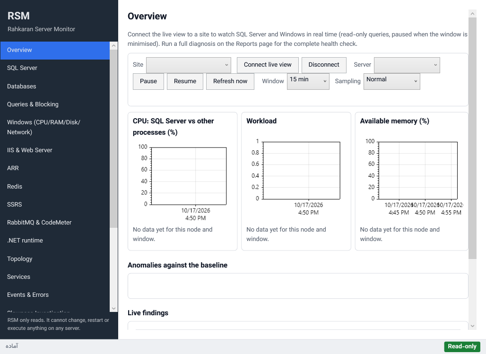
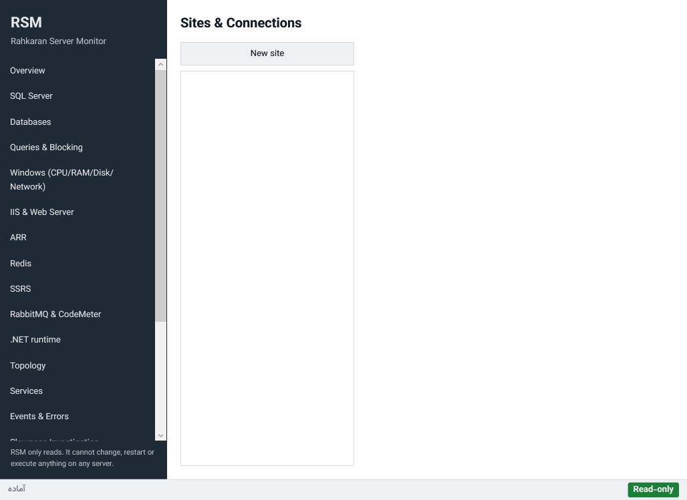
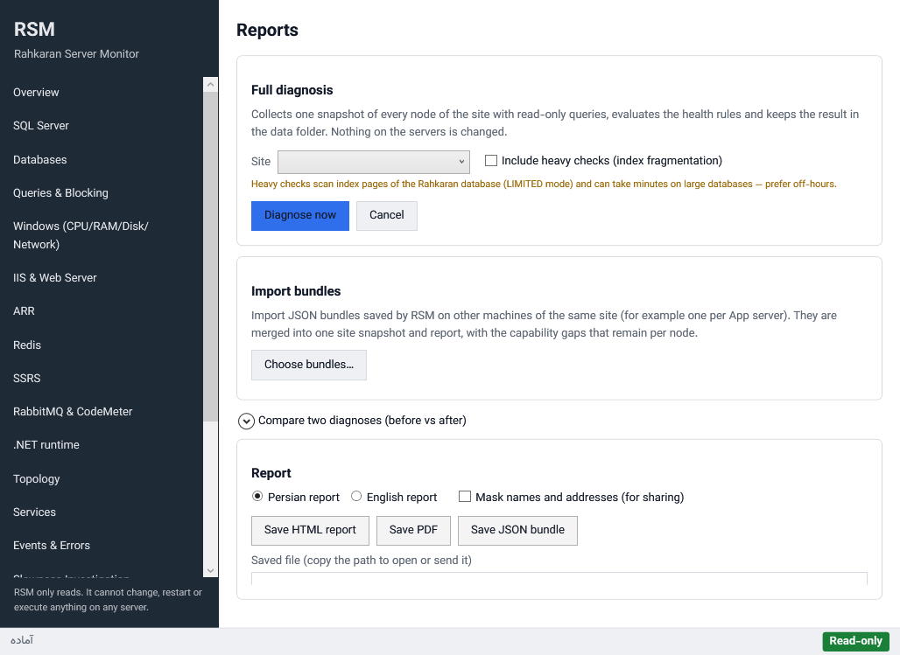
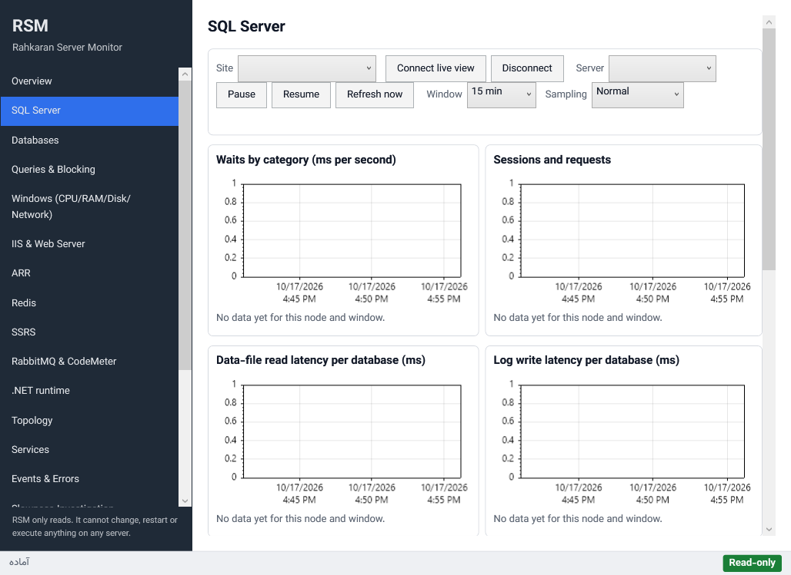
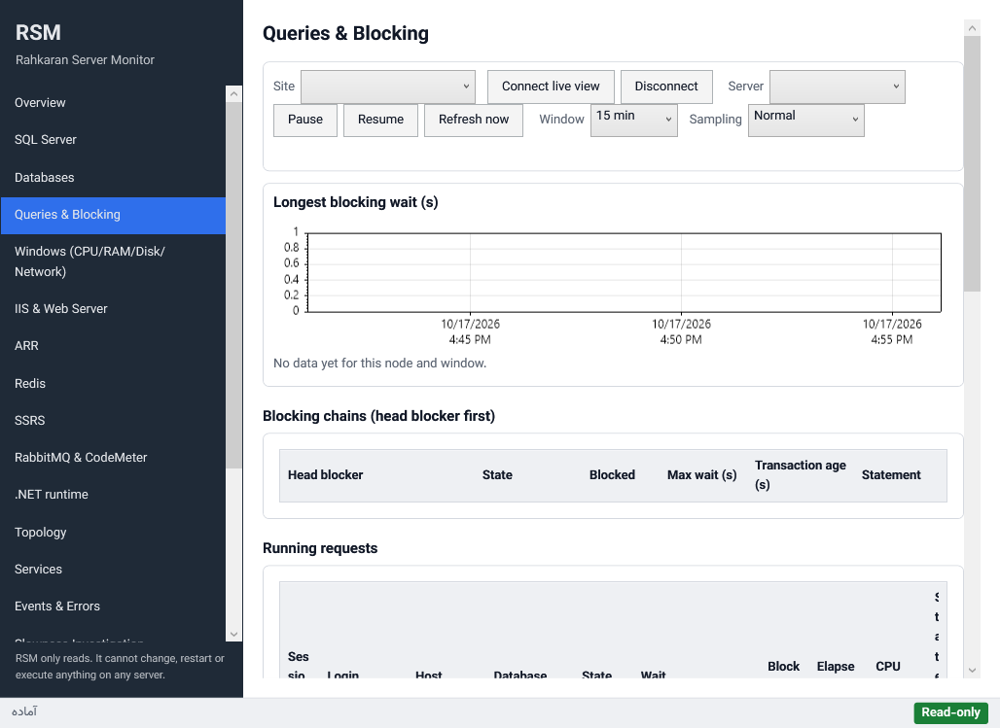
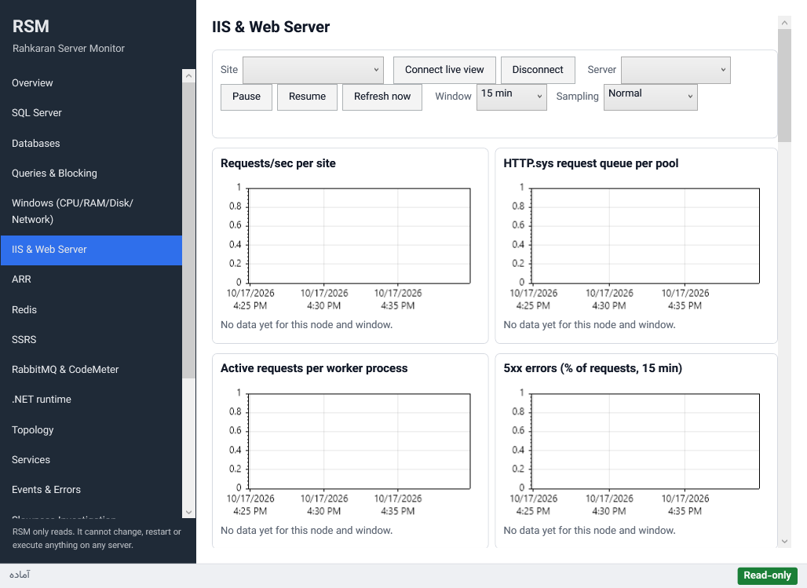
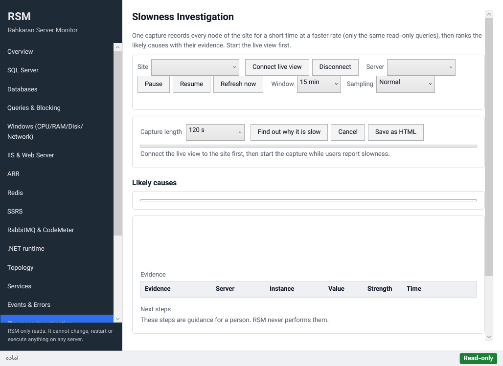
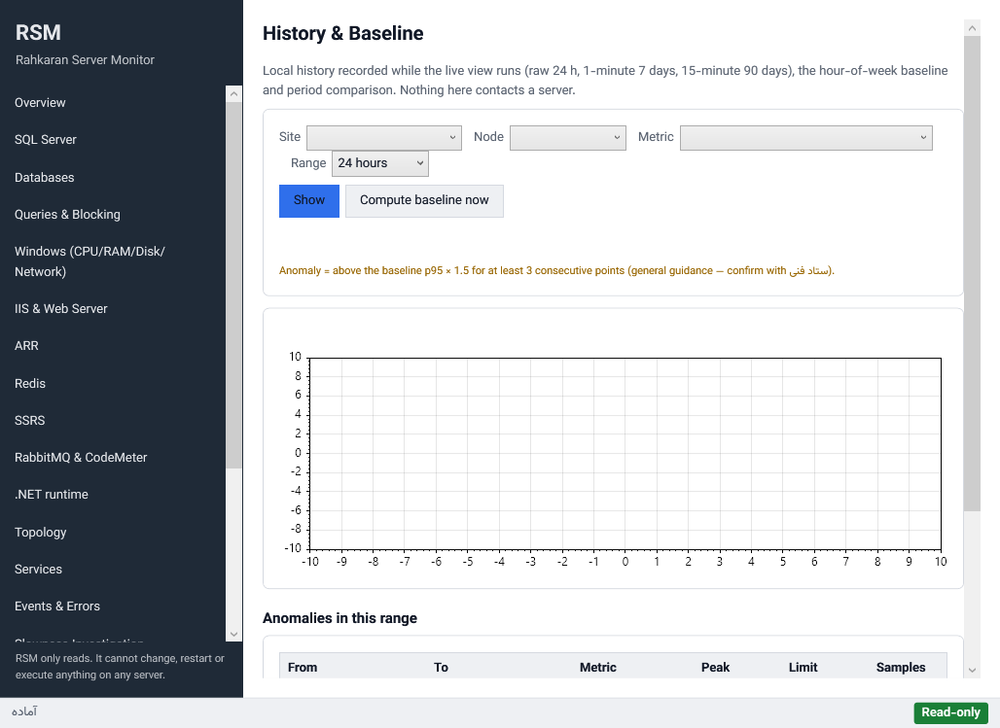
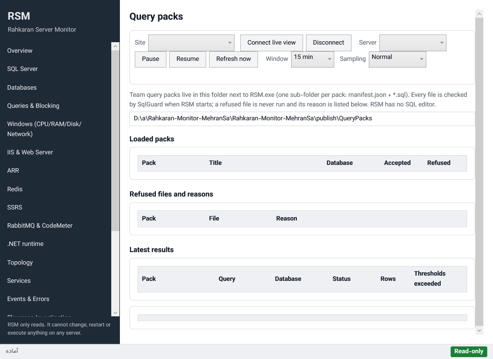

# RSM user guide (English)

Rahkaran Server Monitor (RSM) is a **read-only** diagnostic tool for servers that run Rahkaran on Windows Server, IIS
and SQL Server. It never changes a server. It does not kill, recycle, restart, shrink or "fix" anything, and every
recommendation it gives is text for a person to act on. Persian guide: [README.fa.md](README.fa.md).

> Screenshots come from the published `RSM.exe`. The Windows CI job runs `RSM.exe --portable --ui-snapshots`, which
> shows every page in Persian and English and saves `ui-snapshots/<lang>-<nn>-<page>.png` in the data folder. They are
> published as the `ui-snapshots` artifact of each CI run and copied here as `images/`.

## 1. Start

1. Copy `RSM.exe` to the server or to an admin workstation. It is portable and installs nothing.
   - `RSM.exe --portable` keeps all data (profiles, history, reports, logs) in `data\` next to the exe.
   - Otherwise RSM uses `%LOCALAPPDATA%\RSM`.
2. Run it as a normal user. Some Windows and IIS data needs local administrator rights. RSM never elevates itself; the
   Capability Matrix tells you what is missing and why.
3. On the database server, create the least-privilege login `rsm_monitor` (script and rights in
   [PERMISSIONS.md](../../PERMISSIONS.md)).



## 2. Sites and nodes

**Sites** page: add a site, then its nodes (machines) with their roles:

- Data, Report, App, ARR, Redis, Lock (CodeMeter), Workflow (RabbitMQ).
- SQL Server and Redis endpoints. Secrets are protected with DPAPI for the current user, or not stored.
- **Test connection** fills the Capability Matrix: what works with these credentials, and how to grant what does not.

Rahkaran-specific settings (database names, the version file, ستاد فنی job patterns) are optional and marked
*unverified*.



## 3. Full diagnosis and reports

**Reports** page → **Diagnose** runs every snapshot collector once per node, sequentially and read-only, then
evaluates the rules (see [RULES.md](../../RULES.md)).

- *Heavy* checks (index physical stats, buffer descriptors, plan-cache scans) are off by default and show a time
  estimate.
- Exports, saved in `reports\` in the data folder:
  - **HTML** in Persian or English;
  - **PDF**, printed offline by the built-in WebView2. Without WebView2, the HTML is saved and RSM tells you to print
    it from a browser;
  - **JSON bundle** (zip). *Mask* pseudonymises every name and address for sharing.
- **Import bundles** merges bundles taken on several machines of the same site into one snapshot and report. For
  example, take one bundle on each App server for the local-only IIS data, and one against SQL Server. The report lists
  the source bundles and the capability gaps that remain per node.
- **Compare two diagnoses (before vs after)**: pick an earlier and a later diagnosis, for example around an update.
  RSM shows:
  - findings that are new, resolved or changed severity;
  - numbers that moved by at least 10 % (waits, IIS p95 per site, CPU, memory, file latency…);
  - values that changed (versions, the top statement, top waits).



## 4. Live view

Every live page (Overview, SQL Server, Queries & Blocking, Windows, IIS, ARR, Redis, SSRS, Workflow, .NET runtime,
Topology, Services, Events) shares the toolbar: site, **Connect**, pause/resume, window (15/30/60 min) and interval.

- RSM measures its own overhead and shows it.
- RSM backs off when a collector is slow.
- RSM pauses when the window is minimised.

The **Overview** also lists **anomalies against the baseline**: a metric above its hour-of-week p95 × 1.5 for at least
3 consecutive samples. This is general guidance; confirm it with ستاد فنی.





## 5. Why is Rahkaran slow?

**Slowness** page. Connect the live view first, then start the capture *while users report slowness*.

1. Pick the capture length (default 120 s) and press **Find out why it is slow**.
2. For that time every collector of every node runs at investigation cadence (about three times as often), with the
   same read-only queries.
3. The result is a ranked list of likely causes. Each cause shows:
   - its confidence;
   - its evidence (values, node, time);
   - context (for example the head blocker's statement);
   - a shared timeline of the evidence charts;
   - **text-only next steps**, such as "capture a w3wp dump with ProcDump per the Systemgroup KB, after taking the
     server out of ARR". RSM never performs these steps itself.
4. Investigations are saved; **Save as HTML** exports one. Earlier investigations can be reopened from the list.

The causes and their weights live in `rules/slowness/` (see [RULES.md](../../RULES.md) §12).



## 6. History, baseline and comparison

While the live view runs, RSM records every metric locally:

| Resolution | Kept for |
|---|---|
| raw | 24 h |
| 1-minute | 7 days |
| 15-minute | 90 days |

The **History** page shows:

- **Chart**: a metric of a node over 6 h to 90 days, with the baseline p95, the anomaly limit and shaded anomaly bands.
- **Baseline**: median and p95 per hour of the week (Saturday-first), from the last 4 weeks. It is recomputed daily;
  **Compute baseline now** recomputes it on demand. It needs about two weeks of history.
- **Compare periods**: last week vs this week, or the week before vs the week after a date (e.g. an update). Rows are
  ordered by the largest change.



## 7. Query packs

Optional, user-supplied SQL files next to the exe (`QueryPacks\`).

- Each file is checked by the same read-only guard as RSM's own queries.
- A refused file is listed with the reason.
- RSM has no SQL editor.

See `docs/query-packs/example-table-sizes`.



## 8. Headless: RSM.Cli

`RSM.Cli.exe` uses the same profiles, data folder and read-only collectors. It runs only while the console is open and
never installs a service or a scheduled task.

```
RSM.Cli --snapshot --site "HQ"                      full diagnosis
RSM.Cli --collect --site "HQ" --duration 8h         live collection into local history
RSM.Cli --investigate --site "HQ" --duration 120s   slowness capture + ranked causes
RSM.Cli --export latest --format html|pdf|bundle --lang fa|en [--mask]
RSM.Cli --import db01.zip app01.zip                 import and merge bundles
RSM.Cli --compare <before-id> [<after-id>|latest]   what changed between two diagnoses
RSM.Cli --list                                      sites and recent snapshots
```

Exit codes: 0 ok, 1 usage, 2 failed, 3 not found. PDF needs the desktop app; the CLI saves the HTML instead.

## 9. Data folder

| Folder | Content |
|---|---|
| `sites\` | site profiles (no secrets in clear) |
| `snapshots\` | diagnoses, Brotli JSON |
| `history\<site>_<node>\` | metric history and `baseline.json` |
| `investigations\` | slowness captures and results |
| `reports\` | exports |
| `logs\` | RSM's own log (secrets redacted) |
| `webview2\` | the PDF printer's browser profile |

Deleting the folder removes everything RSM ever wrote.
